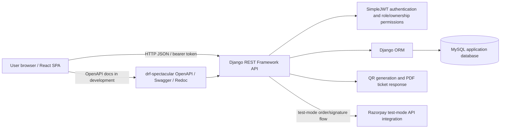
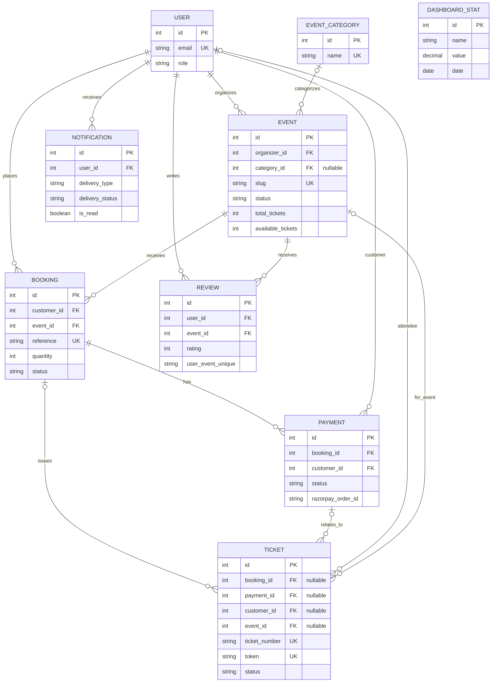
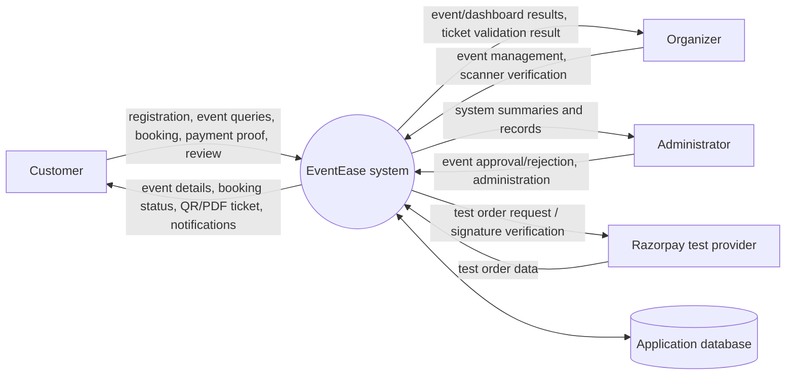
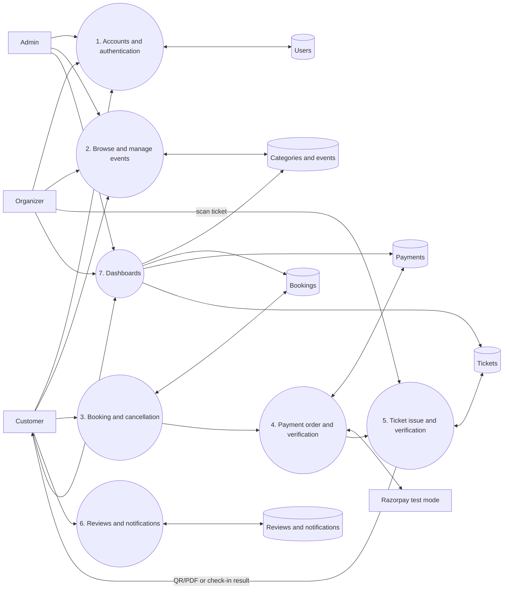
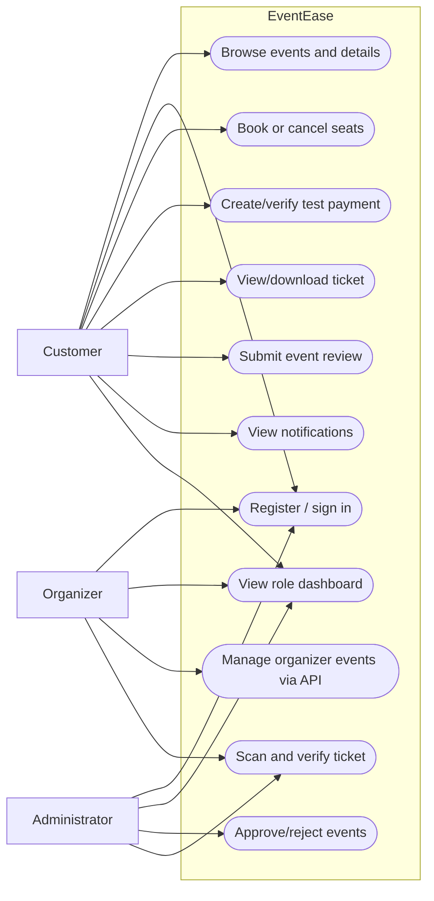

# EventEase Diagrams

The diagrams use Mermaid and are intended to remain editable alongside the source. Database relationships shown are based on model foreign keys and uniqueness constraints.

## System architecture

## ER diagram

DashboardStat is standalone and intentionally has no relationship line. The database enforces unique review per user/event. Ticket foreign keys are nullable in the model. Payment-to-booking is one-to-many at the schema level.

## DFD Level 0 (context)

## DFD Level 1

## Use case diagram

Event creation/approval are represented as backend/API/admin workflows; a dedicated React authoring/approval interface is not currently implemented.
